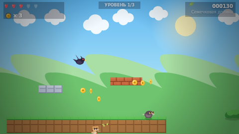
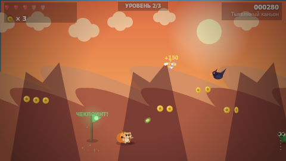
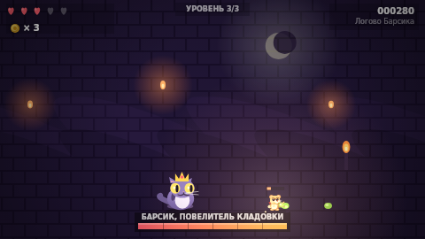

# 🐹 Хомяк-Мститель: Рогатка Судьбы

Платформер в стиле классических «марио-подобных» игр: боевой хомяк Грызь с
рогаткой идёт отбивать у кота-тирана Барсика украденный запас семечек.
Три мира, враги с разными повадками, чекпоинты, босс-файт и полностью
процедурная графика — **ни одного внешнего ассета**: всё рисуется кодом на
canvas, вся музыка и звуки синтезируются через WebAudio.





## Запуск

Игра — статический сайт на ES-модулях, поэтому её нужно открыть через
локальный сервер (просто `file://` не подойдёт):

```bash
python3 -m http.server 3000      # затем открыть http://localhost:3000
# или
npm start                        # то же самое через serve
```

Дальше — «Начать охоту» (или Enter / пробел).

## Управление

| Клавиша | Действие |
| --- | --- |
| `←` `→` / `A` `D` | бежать |
| `Пробел` / `↑` / `W` | прыжок; в воздухе ещё раз — двойной прыжок «надутыми щеками» |
| `J` / `X` / `Z` | рогатка: **держи** — заряжаешь, **отпусти** — стреляешь |
| `P` / `Esc` | пауза |
| `M` | звук вкл/выкл |
| `R` | перезапустить уровень |

На телефоне и планшете включаются экранные кнопки.

## Механики

- **Три уровня заряда рогатки.** Короткое нажатие — лёгкая семечка, средний
  заряд — тяжёлая (больше урона), полный — зелёный «отскакивающий» горошек:
  рикошетит от стен до трёх раз и пробивает двух врагов.
- **Автоприцел.** Хомяк сам поднимает рогатку на ближайшего врага в пределах
  ~200 px, так что стрелять по летающим воронам удобно даже с земли.
- **Сердца и орехи.** 5 сердец максимум, а орех при полном здоровье даёт
  «Ореховую ярость» на 10 секунд: ускорение, усиленные выстрелы и возможность
  разбивать кирпичные блоки головой.
- **Чекпоинты.** Флажки сохраняют точку возрождения; падение в яму отнимает
  сердце и возвращает к последнему флажку.
- **Враги.** Кроты-грызуны (топчешь сверху), вороны (летают и преследуют),
  кактусы-стражники (стреляют колючками, топтать нельзя — только рогатка).
- **Босс 3-го уровня — кот Барсик.** Просыпается, когда подходишь; чередует
  таран, прыжки с динамитом и контузию после удара о стену. В контузии
  получает двойной урон — это и есть окно для атаки.
- **Секретные блоки.** Блоки «?» выдают семечки, некоторые — орех-сердце.

## Структура

```
index.html      — каркас, canvas, оверлей экранов, тач-кнопки
styles.css      — оформление меню и HUD-панелей
src/core.js     — константы, математика, AABB, детерминированный «шум»
src/input.js    — клавиатура + виртуальные кнопки (pointer events)
src/audio.js    — синтез SFX и трёх музыкальных треков (WebAudio)
src/levels.js   — тайлмап, палитры и «конструктор» трёх уровней
src/art.js      — вся графика: фон, тайлы, хомяк, враги, босс, эффекты
src/entities.js — физика, хомяк, враги, снаряды, предметы
src/game.js     — игровой цикл, камера, столкновения, HUD, экраны уровня
src/main.js     — меню, пауза, победа/проигрыш, requestAnimationFrame
```

Уровни описываются кодом в `src/levels.js` через маленький билдер
(`b.platform()`, `b.enemy()`, `b.qblock()` …), поэтому их легко править и
невозможно «рассинхронизировать» по длине строк.

## Технические детали

- Фиксированный шаг симуляции 1/60 с с аккумулятором — физика не зависит от FPS.
- Раздельная коллизия по осям с «койот-таймом» (0.1 с) и буфером прыжка,
  чтобы управление ощущалось отзывчивым.
- Камера с плавным догонянием и parallax-фоном (холмы, облака, скалы, стены
  логова с факелами).
- Рендер в 480×270 с `image-rendering: pixelated` и масштабированием под окно.
- Ноль зависимостей: только нативные Canvas 2D, WebAudio и ES-модули.
